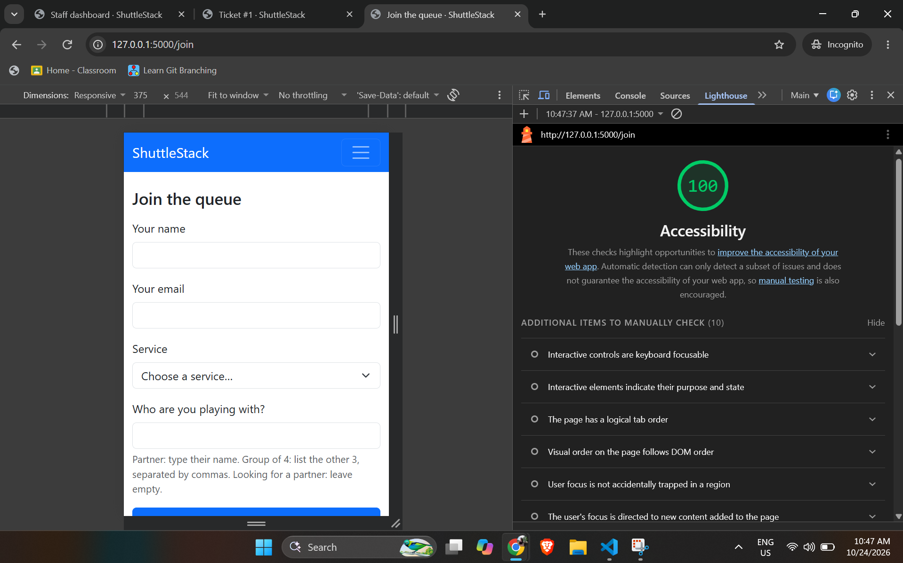
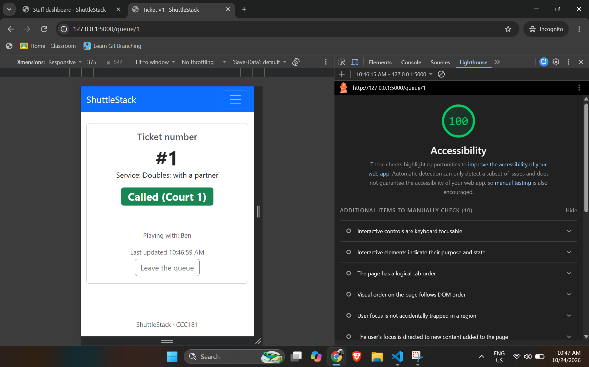
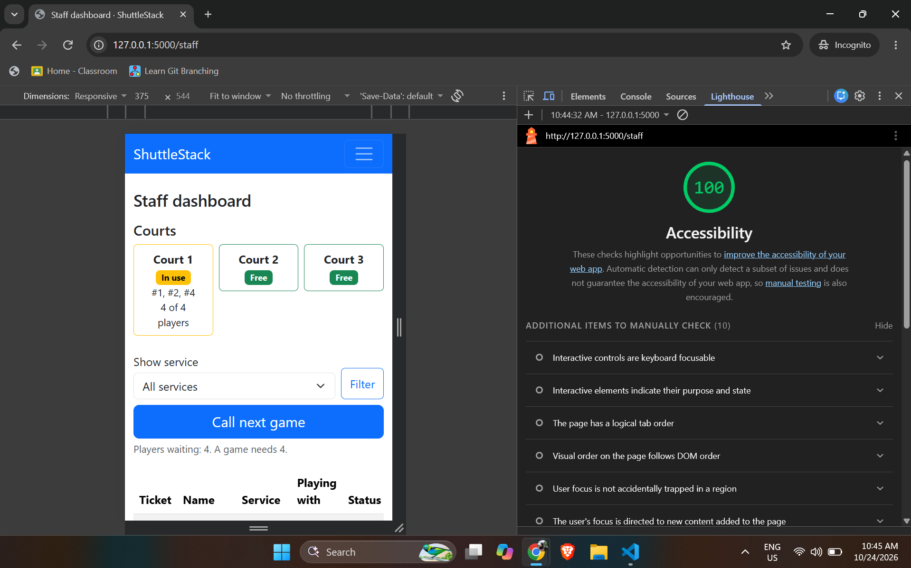

# Week 3 Accessibility Check: ShuttleStack

Date tested: 24 October 2026. Browser: Google Chrome (incognito window, so extensions did not affect results). Tested on all three screens: Join, My place and Staff dashboard.

## 9a. Lighthouse (Accessibility, Mobile)

| Screen | Score | Screenshot |
|---|---|---|
| Join | 100 |  |
| My place | 100 |  |
| Staff dashboard | 100 |  |

All three screens meet the 90+ target. Lighthouse reported no failed audits. It listed 10 items to check manually (keyboard focus, tab order, focus traps and similar), which are covered in 9b and 9c below.

## 9b. Keyboard-only test

I used only Tab, Shift+Tab, Enter, Space and the arrow keys. Focus was visible at every step and every control could be reached and used.

| # | Check | Result |
|---|---|---|
| 1 | On the home page, the first Tab shows the "Skip to main content" link, and Enter jumps focus past the navbar | Pass |
| 2 | Join: completed and submitted the form with the keyboard only, choosing the service with the arrow keys | Pass |
| 3 | Join: after choosing "Doubles: looking for a partner", Tab skips the hidden partner field | Pass |
| 4 | Staff dashboard: filtered by service, pressed Call next game, then served a ticket | Pass |
| 5 | Staff dashboard: the No-show confirmation popup can be answered with the keyboard | Pass |
| 6 | My place: Tab reaches Leave the queue and its confirmation popup can be answered with the keyboard | Pass |

Nothing failed in the keyboard test.

## 9c. Manual checklist

| Check | Join | My place | Staff |
|---|---|---|---|
| Every input has a visible label | ✅ Name, email, service and partner each have a `<label for>` | n/a (no inputs) | ✅ The service filter has a label |
| Error messages say what to do, in text | ✅ Text under each wrong field plus a red alert | ✅ "Can't refresh. Check your connection." appears if the update fails | ✅ Warning messages explain why (for example "Not enough players yet to fill a game of 4") |
| Status is shown in words, not only color | n/a (no status on this screen) | ✅ Badge reads "Waiting", "Called (Court N)", "Served" or "No-show" | ✅ "Waiting", "Called (Court N)", "Free", "In use" and "Needs N more" |
| Text and buttons are readable at 375 px with no sideways page scroll | ✅ | ✅ | ✅ The table scrolls sideways inside its own box, the page does not |
| Buttons are at least about 44 × 44 px on a phone | ✅ after fix (see below) | ✅ after fix (see below) | ✅ Serve, No-show and Filter already had a 44 px minimum height |
| Page has one `<h1>` and headings in order | ✅ | ✅ | ✅ One `<h1>`, then `<h2>` for Courts |
| `<html lang="en">` is set | ✅ (set once in `base.html`) | ✅ | ✅ |

## Issues found and fixed

1. **Tap targets too short.** The Leave the queue button (My place) and the Get a ticket button (Join) were shorter than about 44 px. I set a minimum height of 44 px on both, then re-checked them in Chrome DevTools and confirmed the height is now 44 px or more.
2. **Outdated hint text on Join.** The partner hint still said "Looking for a partner: leave empty" even though the partner field is now hidden for that service. I changed the hint so it matches the new behavior.

## What is left

Nothing that blocks the Week 3 target. Lighthouse only checks a subset of accessibility issues, so a screen reader test was not done this week.