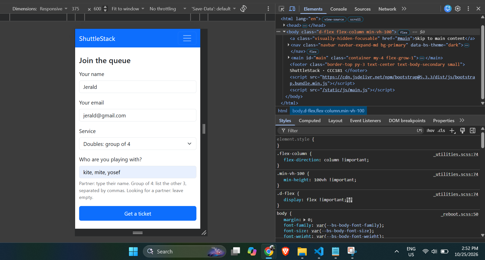
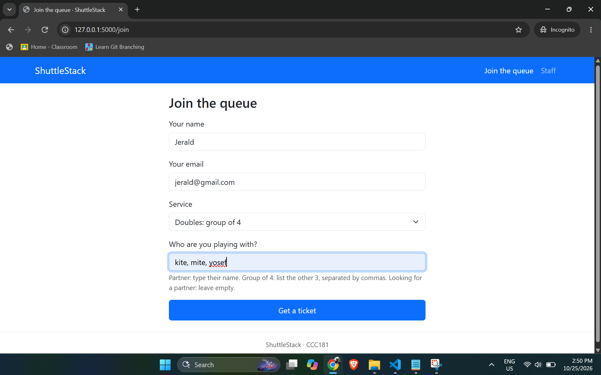
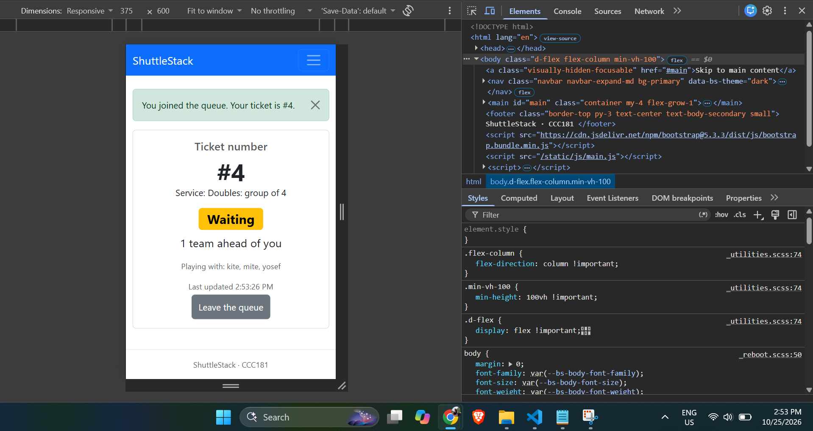
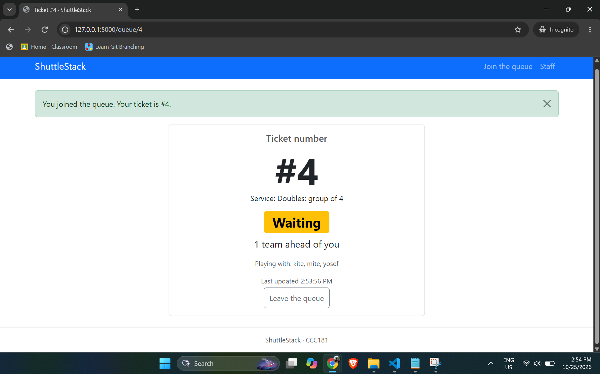
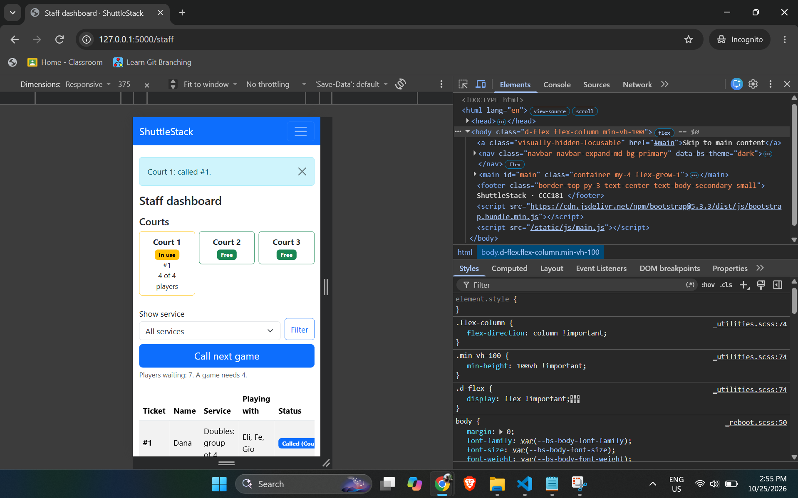
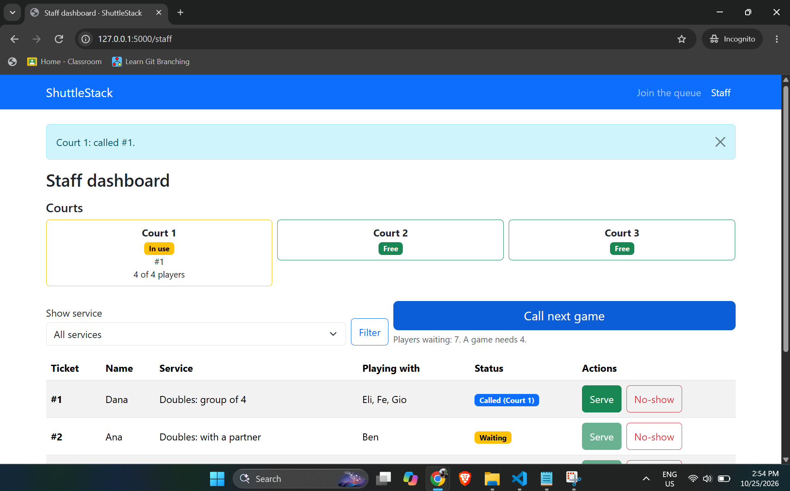
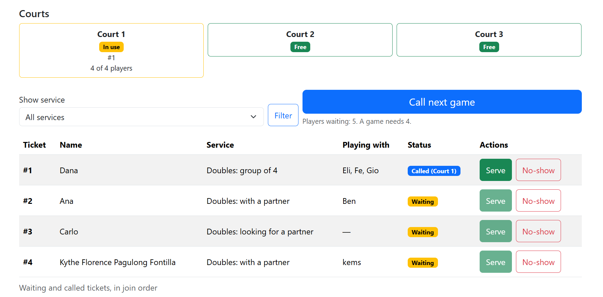
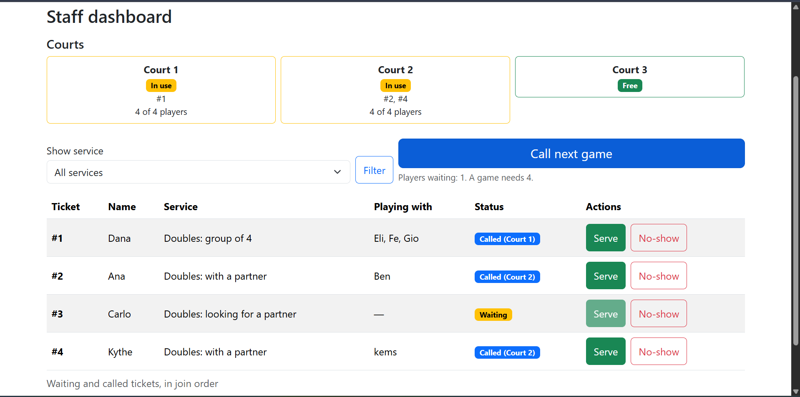

# ShuttleStack: Week 3 Report

## 1. Title details

- **App:** ShuttleStack
- **Setting:** a public badminton venue with 3 courts in Wet Market, Iligan City and a flat 50-peso all-day entry fee
- **Name:** Kythe Florence Fontilla
- **Student ID:** 2024-0812
- **Section:** CS3B
- **Date:** October 25, 2026
- **Pull request:** https://github.com/kythe-fontilla/CCC181/pull/2

## 2. Personas

Full personas are in [personas.md](personas.md).

**Jerald, the player (24, working adult).** "i want to have a tangible place where i could see the queue and the current status of the ones playing in court." *(interview)*
Top tasks: join the queue as a pair, a group of four, or alone (FR-01); check ticket number, status and teams ahead (FR-02); leave the queue (FR-04).

**Swishy, the caretaker (20).** "just memory or estimate lang" *(interview)*
Top tasks: see the waiting list in order and call, serve or mark a no-show (FR-03); assign a called ticket to a court and see which courts are in use (FR-05).

## 3. Screens

(Take these six screenshots and save them in `docs/week3/screenshots/`. Take the staff ones with a game on a court, so the star feature is visible.)

**Join, phone.** Used by Jerald on his phone. Covers FR-01.

**Join, laptop.** Used by Jerald. Covers FR-01.

**My place, phone.** Used by Jerald on his phone. Covers FR-02 and FR-04.

**My place, laptop.** Used by Jerald. Covers FR-02 and FR-04.

**Staff dashboard, phone.** Used by Swishy on her phone. Covers FR-03 and FR-05.

**Staff dashboard, laptop.** Used by Swishy at a computer. Covers FR-03 and FR-05.

## 4. Design decisions

1. **One join form for all three services, with "Who are you playing with?".**  Jerald comes as a pair, a group, or alone, so one form works for every case. The partner field hides itself when he is looking for a partner and a message below the input field for instruction while inputing the name of other players. *(Jerald's rule 4, and the self-review of the Join screen.)*
2. **The ticket number and the status are the biggest things on My place, in words.** Jerald warms up or leaves the court to eat, so he needs to read his status at a glance. The page also updates itself every 10 seconds. *(Jerald's rule 1.)*
3. **Calling a game is one large tap, and courts are assigned automatically.** Swishy's hands are often busy with money, so Call next game picks the players and a court in one tap instead of asking her to choose a court each time. *(Swishy's rule 5, and the staff self-review.)*

## 5. Self-review

Full review in [feedback.md](feedback.md).

- **Join:** the partner hint was unclear for a group of 4. I changed the hint text and added exact-count checks on the server.
- **My place:** nothing showed when the page last updated or when a refresh failed. I added a "Last updated" time and a "Can't refresh" message in Part 8.
- **Staff dashboard:** there was no way to see courts and Serve showed on tickets that could not be served. I added the court strip and made Serve available only on called tickets. Instead of card for each team/player, I made it as a table and removed call button on each row so that the staff no longer needs to constantly see through the table and just proceed to one tap through the big 'call next game' button on the top of the table.

## 6. Accessibility

Full results in [accessibility.md](accessibility.md).

Lighthouse accessibility scores (mobile): Join 100, My place 100, Staff dashboard 100. The most important issue I fixed was tap targets: the Leave the queue and Get a ticket buttons were shorter than about 44 px, so I set a minimum height of 44 px.

## 7. Usability test

Full notes in [usability-test.md](usability-test.md).

One tester, who matches Jerald, finished all three tasks without help in about 2 minutes. Joining took about 20 seconds, finding his number and position took a split second, and calling and serving a team took under 20 seconds. He had trouble finding the staff dashboard because I had not set it up in its own tab.

**Improvement:** he tried to call another game because the dashboard said 5 players were waiting, but the button refused. A free court was idle because an incomplete game ahead blocked two tickets that could fill it together. I changed the queue to pick the earliest set of waiting tickets that makes exactly 4 players.

**Before:**

**After:**

## 8. Reflection

**What was hardest.** The hardest parts this week were the wireframes and the staff dashboard. For the wireframes, I had to keep asking whether each screen met the needs of my personas. Where every input and button went mattered too, because the screen had to be easy to use and follow the order in which people do things. The staff dashboard was hard for a different reason. The first version was simple, but one ticket does not equal one court in this problem, so I had to rework how games are formed.

**Groups I did not support.** Groups of 3 are not supported, and neither are larger groups that want to play only among themselves, for example a group of 8. I did not observe either case at the venue, so I did not add them, but both are possible. Any amount of group would need a service for it and a way to match it with more/other player.

**Singles (not built).** The tester suggested that when few players are waiting, players who joined without a partner or team could play singles, and that the staff could assign it if the players want it. *(interview, Part 10)* I did not build this week. A possible design is a second button for the caretaker that calls the earliest waiting tickets to a free court even when they total fewer than 4 players.

**Loosening strict join order.** At first, a game was always built starting from the longest-waiting ticket, so nobody was passed over. During the test, a free court sat idle because an incomplete game at the front blocked two pairs (#2 and #4) who could have played together, while a solo (#3) waited between them. I decided that an idle court with four ready players is worse than the small unfairness of calling them first. The passed-over ticket keeps its number and is tried first again next time. The cost is that join order is no longer strict, and Swishy cannot always settle a dispute by pointing to the earliest ticket. If disputes appear, I would show the reason a ticket was passed over.

**Automatic court assignment.** Court assignment is automatic: Call next game picks the players and gives them the first free court, or fills a short court first. I did this because Swishy's hands are often busy with money, so calling a game should take one large tap, not extra choices. *(personas, Swishy's rule 5)* The cost is that she cannot choose a specific court, and the wireframes do not show a control for it. I recorded this gap in `feedback.md`.

**FR-06 is out of scope.** FR-06 (games played and wait time per team) is a later item. Swishy decides by the team that waited longest or played fewer games *(interview)*, but this week the app only uses join order and ticket numbers. Tracking games played means keeping a history for each team, which fits better once the data is stored in a database.

**Bootstrap and mobile data.** Bootstrap loads from a CDN, which uses mobile data on the first visit and is in tension with Jerald's light-page rule, because there is no Wi-Fi at the court. I did not measure the page weight this week. Later I could host a smaller stylesheet myself and test on a phone with mobile data.

**What changes in Week 4.** The data lives in a Python list, so it resets whenever the server restarts. When it moves to PostgreSQL, tickets will persist, and ticket numbers, the "teams ahead" count, the court and the number of players will be stored and queried instead of being worked out from the list. I expect the look of the screens to stay the same, but My place and the staff dashboard will read from the database.

## 9. Declaration

I used Claude (an AI assistant) for guidance on the Flask code, templates and JavaScript, and for drafting the accessibility, which I checked against my own results.