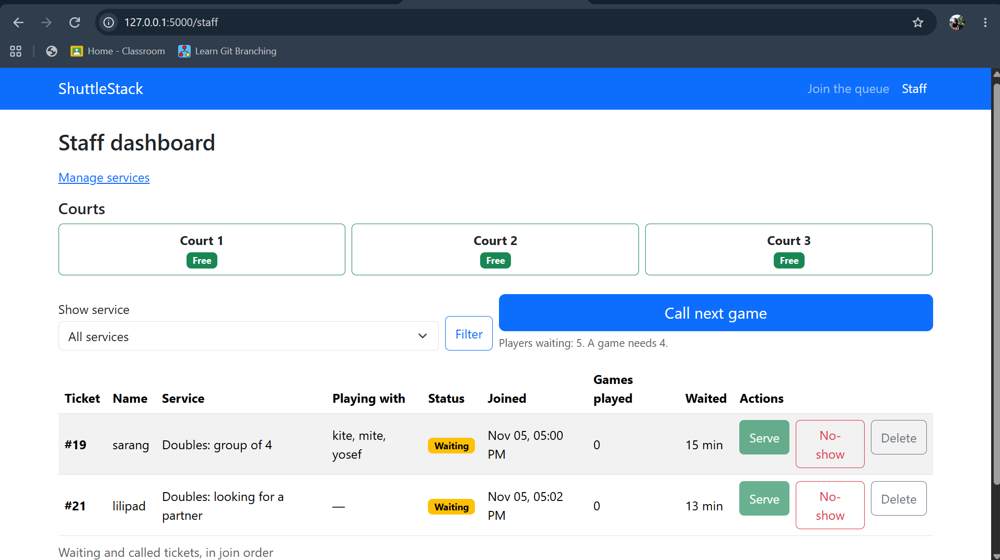
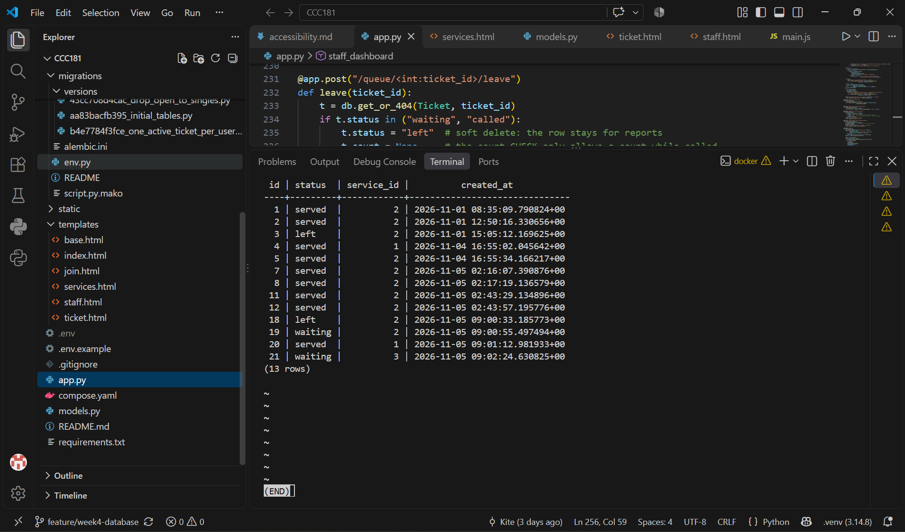
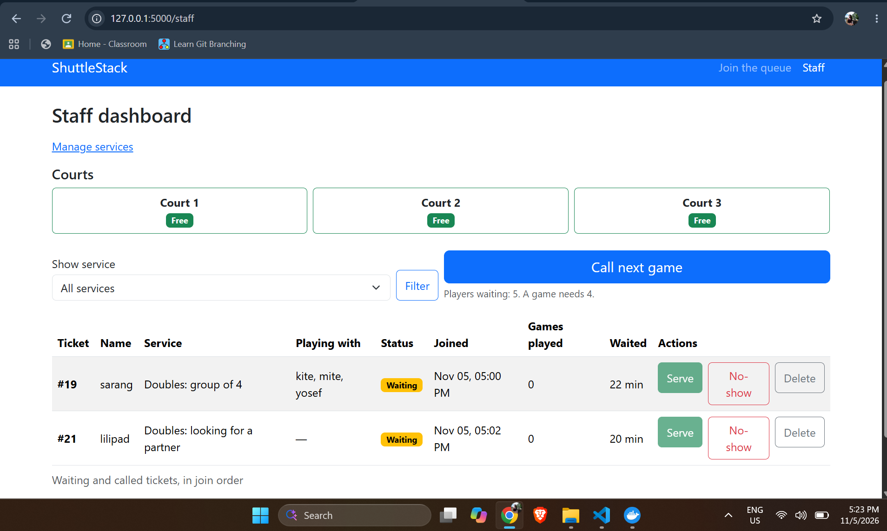
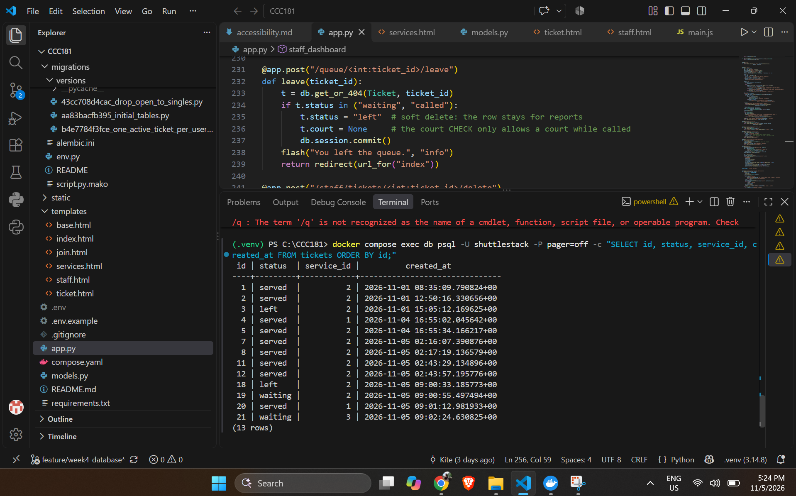

# Week 4 persistence: ShuttleStack

This checks NFR-01: no ticket is lost when the server or the database restarts.

## 11a. Restart test

### Before the restart

The database held 13 tickets across three services (1, 2 and 3), with the statuses `served`, `left` and `waiting`.

Query used (in PowerShell):

```
docker compose exec db psql -U shuttlestack -P pager=off -c "SELECT id, status, service_id, created_at FROM tickets ORDER BY id;"
```

Staff dashboard before the restart (it lists the waiting and called tickets):



Query result before the restart:



### Steps

1. Stopped Flask with Ctrl+C.
2. Ran `docker compose down`. This removes the container but keeps the `pgdata` volume.
3. Ran `docker compose ps` and saw that nothing was running.
4. Ran `docker compose up -d` and waited until `docker compose ps` showed the database as healthy.
5. Started Flask again with `flask --app app run --debug`.

I did not join, call, serve, leave or delete anything between the two sets of screenshots.

### After the restart

Staff dashboard after the restart:



Query result after the restart:



### Result

All 13 tickets, their statuses, their services and their `created_at` times are identical before and after the restart. The data lives in the `pgdata` volume, not in the container or in Flask, so it survives. NFR-01 **passed**.

## 11b. Rebuild from scratch

TODO: fill this in after running the rebuild.