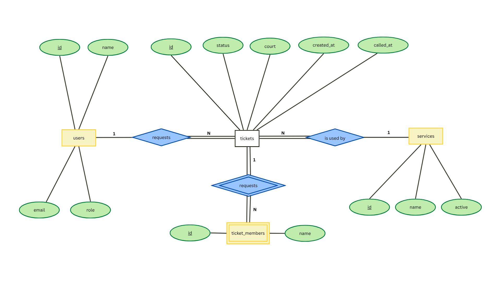
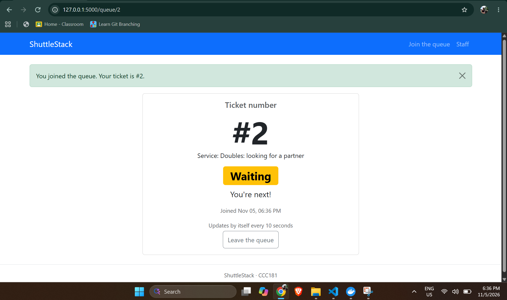
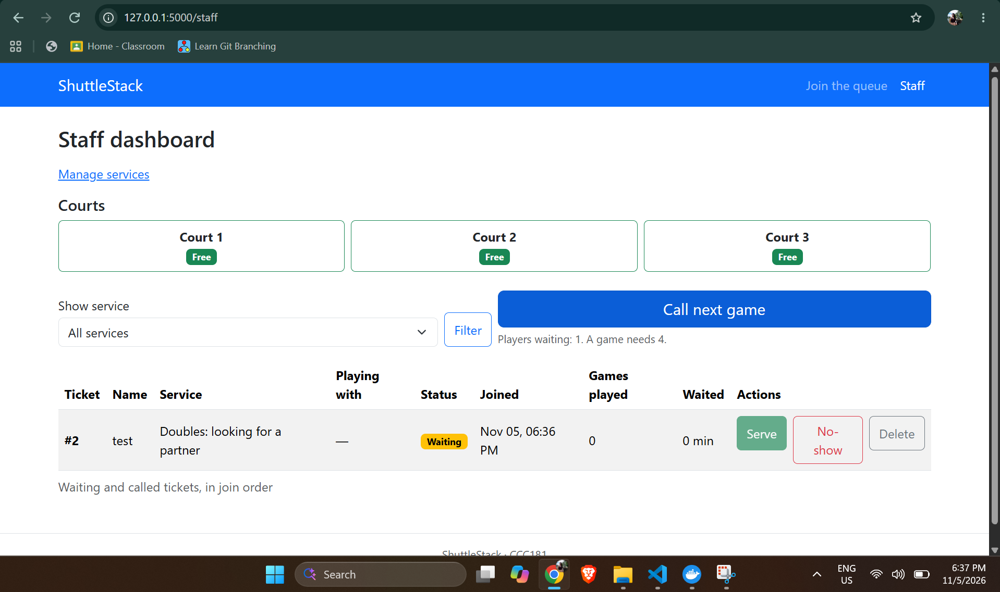
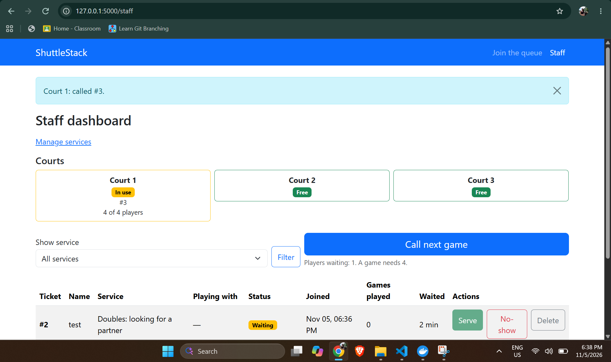
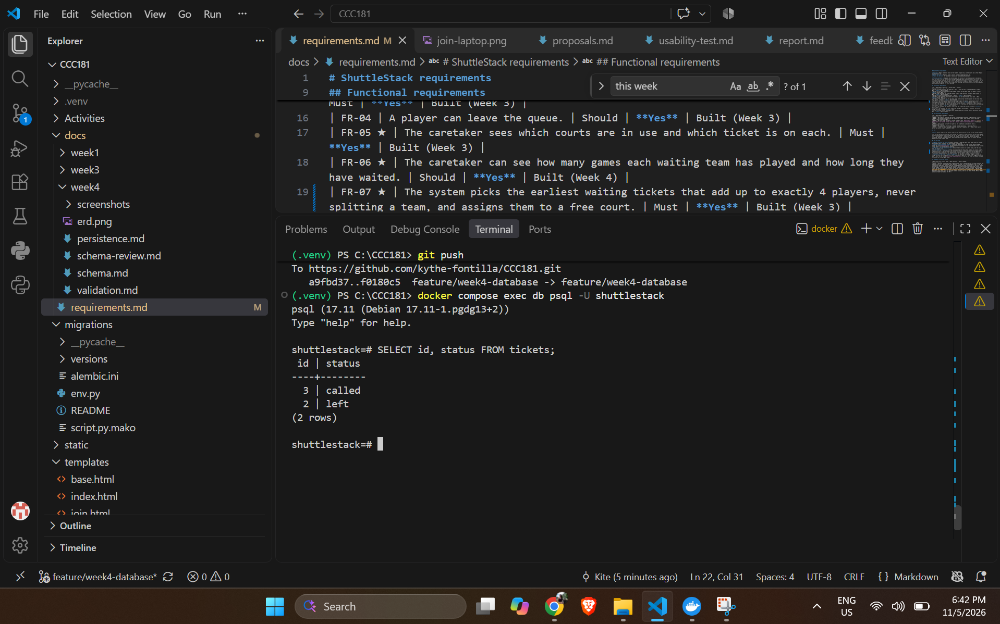
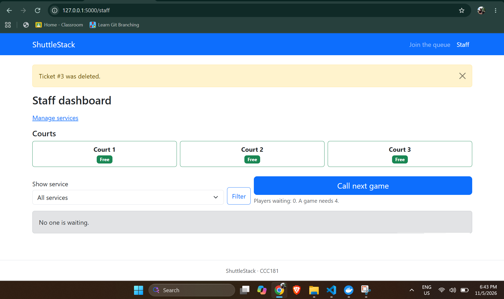
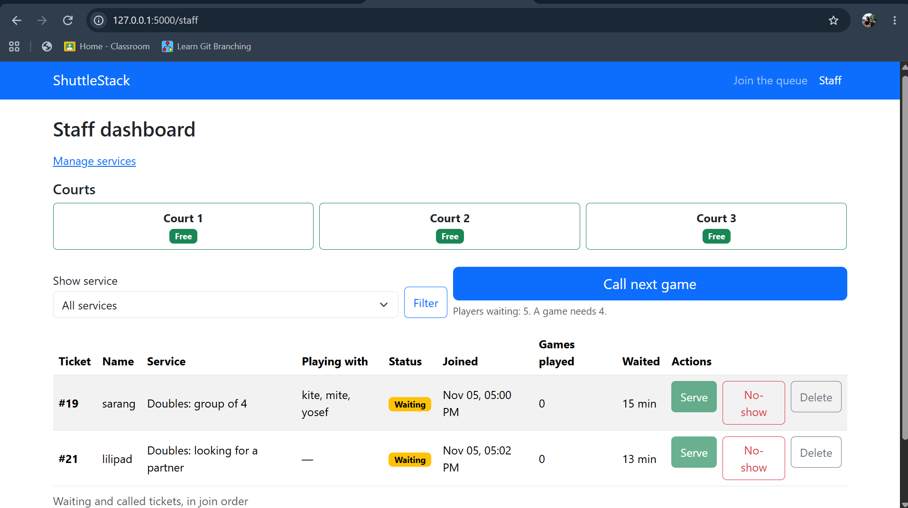
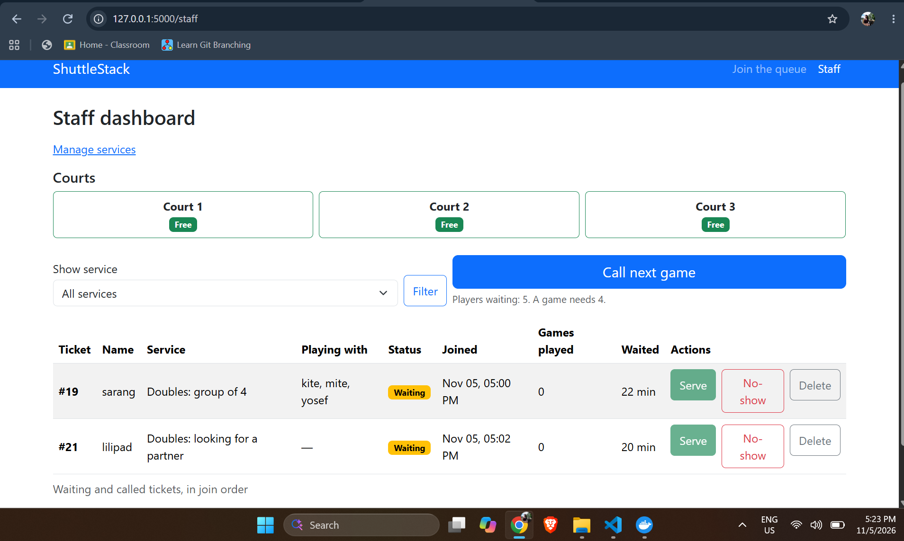
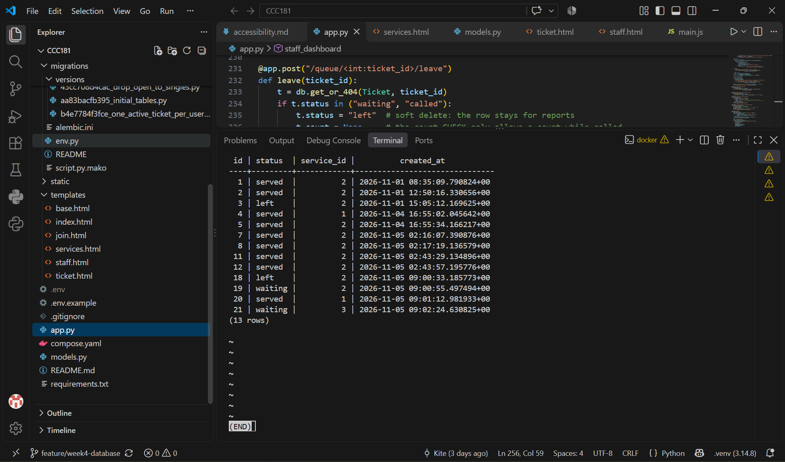
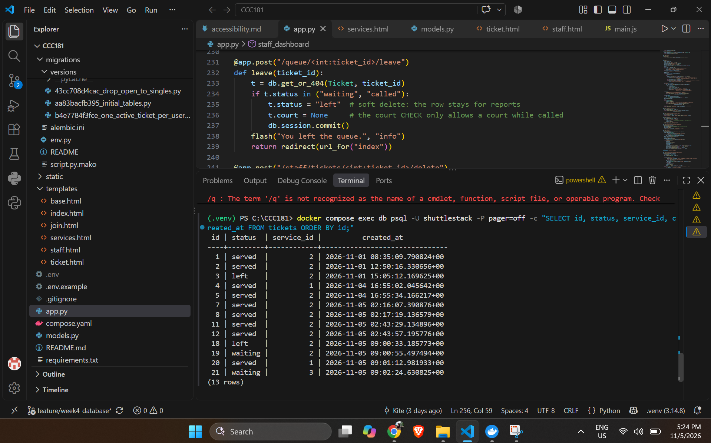

# ShuttleStack: Week 4 Report

## 1. Title details

- **App:** ShuttleStack
- **Setting:** a public badminton venue with 3 courts in Wet Market, Iligan City and a flat 50-peso all-day entry fee
- **Name:** Kythe Florence Fontilla
- **Student ID:** 2024-0812
- **Section:** CS3B
- **Date:** November 5, 2026
- **Pull request:** https://github.com/kythe-fontilla/CCC181/pull/4
- **Database:** PostgreSQL 17 in Docker (no local fallback used)

## 2. Requirements

Full list in [requirements.md](../requirements.md).

I wrote **12 functional requirements** (FR-01 to FR-12, five marked ★) and **6 non-functional requirements** (NFR-01 to NFR-06). Eleven of the twelve functional requirements store data.

**MVP:** FR-01, FR-02, FR-03, FR-05, FR-07, FR-09, FR-12, NFR-01, NFR-02, NFR-04, NFR-05, NFR-06. This is the smallest version that still solves the problem: a player can join and see their place without asking anyone, the caretaker can see the waiting list and the courts in use, she can call a full game of 4 onto a free court, and tickets survive a restart.

**Checked with a real person.** A player from the venue read the list. He found nothing missing, and his top three were FR-02, FR-01 and FR-03, which are all Must and in the MVP. He asked why FR-06 (games played and wait time) was marked Later, because it keeps play and waiting fair. I raised FR-06 to this week and built it.

## 3. ERD



- One user requests many tickets over time. Each ticket belongs to exactly one user.
- One service is used by many tickets. Each ticket belongs to exactly one service.
- One ticket includes many ticket members. Each member belongs to exactly one ticket.

`ticket_members` is a weak entity, because a member name means nothing without its ticket. Full design in [schema.md](schema.md).

## 4. Schema

Output of `\d` in psql for each table.

```
(.venv) PS C:\CCC181> docker compose exec db psql -U shuttlestack -P pager=off -c "\d users"
                                    Table "public.users"
 Column |          Type          | Collation | Nullable |              Default              
--------+------------------------+-----------+----------+-----------------------------------
 id     | integer                |           | not null | nextval('users_id_seq'::regclass)
 name   | character varying(80)  |           | not null | 
 email  | character varying(120) |           | not null | 
 role   | character varying(20)  |           | not null | 'visitor'::character varying
Indexes:
    "users_pkey" PRIMARY KEY, btree (id)
    "users_email_key" UNIQUE CONSTRAINT, btree (email)
Check constraints:
    "ck_users_role" CHECK (role::text = ANY (ARRAY['visitor'::character varying, 'staff'::character varying]::text[]))
Referenced by:
    TABLE "tickets" CONSTRAINT "tickets_user_id_fkey" FOREIGN KEY (user_id) REFERENCES users(id) ON DELETE RESTRICT
```

```
(.venv) PS C:\CCC181> docker compose exec db psql -U shuttlestack -P pager=off -c "\d services"
                                   Table "public.services"
 Column |         Type          | Collation | Nullable |               Default                
--------+-----------------------+-----------+----------+--------------------------------------
 id     | integer               |           | not null | nextval('services_id_seq'::regclass)
 name   | character varying(60) |           | not null | 
 active | boolean               |           | not null | true
Indexes:
    "services_pkey" PRIMARY KEY, btree (id)
    "services_name_key" UNIQUE CONSTRAINT, btree (name)
Referenced by:
    TABLE "tickets" CONSTRAINT "tickets_service_id_fkey" FOREIGN KEY (service_id) REFERENCES services(id) ON DELETE RESTRICT
```

```
(.venv) PS C:\CCC181> docker compose exec db psql -U shuttlestack -P pager=off -c "\d tickets"
                                       Table "public.tickets"
   Column   |           Type           | Collation | Nullable |               Default               
------------+--------------------------+-----------+----------+-------------------------------------
 id         | integer                  |           | not null | nextval('tickets_id_seq'::regclass)
 status     | character varying(20)    |           | not null | 'waiting'::character varying
 court      | integer                  |           |          | 
 created_at | timestamp with time zone |           | not null | now()
 called_at  | timestamp with time zone |           |          | 
 user_id    | integer                  |           | not null | 
 service_id | integer                  |           | not null | 
Indexes:
    "tickets_pkey" PRIMARY KEY, btree (id)
    "uq_tickets_one_active_per_user" UNIQUE, btree (user_id) WHERE status::text = ANY (ARRAY['waiting'::character varying, 'called'::character varying]::text[])
Check constraints:
    "ck_tickets_court" CHECK (court IS NULL OR court >= 1 AND court <= 3 AND status::text = 'called'::text)
    "ck_tickets_status" CHECK (status::text = ANY (ARRAY['waiting'::character varying, 'called'::character varying, 'served'::character varying, 'no-show'::character varying, 'left'::character varying]::text[]))
Foreign-key constraints:
    "tickets_service_id_fkey" FOREIGN KEY (service_id) REFERENCES services(id) ON DELETE RESTRICT
    "tickets_user_id_fkey" FOREIGN KEY (user_id) REFERENCES users(id) ON DELETE RESTRICT
Referenced by:
    TABLE "ticket_members" CONSTRAINT "ticket_members_ticket_id_fkey" FOREIGN KEY (ticket_id) REFERENCES tickets(id) ON DELETE CASCADE
```

```
(.venv) PS C:\CCC181> docker compose exec db psql -U shuttlestack -P pager=off -c "\d ticket_members"
                                     Table "public.ticket_members"
  Column   |         Type          | Collation | Nullable |                  Default                   
-----------+-----------------------+-----------+----------+--------------------------------------------
 id        | integer               |           | not null | nextval('ticket_members_id_seq'::regclass)
 ticket_id | integer               |           | not null | 
 name      | character varying(80) |           | not null | 
Indexes:
    "ticket_members_pkey" PRIMARY KEY, btree (id)
Foreign-key constraints:
    "ticket_members_ticket_id_fkey" FOREIGN KEY (ticket_id) REFERENCES tickets(id) ON DELETE CASCADE
```

## 5. Design decisions

1. **The other players are rows in `ticket_members`, not a text list.** In Week 3 the `partner` field held "Eli, Fe, Gio" in one cell, which breaks one value per cell. Jerald joins as a pair, a group of four or alone, so each ticket can have zero to three other names. One row per name makes the player count easy to compute (1 plus the number of members) without storing a copy that could drift out of sync. *(FR-01, Jerald's rule 4)*
2. **"One active ticket per player" is enforced by a partial unique index, as well as by Flask.** Swishy settles turn disputes by guessing, so a player holding two places in line would make it worse. `join()` checks first and shows a clear message, but the index `uq_tickets_one_active_per_user` on `user_id WHERE status IN ('waiting', 'called')` means PostgreSQL refuses the second ticket even if a bug skipped the Flask check. *(FR-12, NFR-02)*
3. **Leaving the queue is a soft delete, and only a mistaken ticket is hard deleted.** When a player leaves, the row stays with status left, so past visits remain in the data. A ticket created by mistake (FR-10) is really deleted, and its member rows go with it through `ON DELETE CASCADE`. *(FR-04, FR-06, FR-10)*

## 6. Self-review

Full review in [schema-review.md](schema-review.md).

- **Bad data:** `court` and `status` could disagree, for example a `waiting` ticket with `court = 2`, which would make the court strip show a court as busy when it is not. I added the CHECK `ck_tickets_court`.
- **Coverage:** `users.role` is not read by any code this week. I kept it, because FR-03 and FR-09 name the caretaker as a different kind of user, and it has a CHECK limited to `visitor` and `staff`.
- **Facts, not results:** games played is counted for the ticket owner only, because listed members are plain names and not accounts. I kept the schema and state the limit here: "games played" means the games the owner has served, which stands for the team.

## 7. Migrations

| Migration | What it does |
| --- | --- |
| `aa83bacfb395_initial_tables` | Creates `users`, `services`, `tickets` and `ticket_members` with their keys, CHECK constraints and defaults. |
| `b4e7784f3fce_one_active_ticket_per_user` | Adds the partial unique index `uq_tickets_one_active_per_user`. The activity's example second migration (adding `services.active`) would have been empty for me, because `active` was already in the first migration, so my second migration is the index that enforces FR-12. |
| `43cc708d4cac_drop_open_to_singles` | Drops `tickets.open_to_singles`. I removed the checkbox after deciding that singles is offered through Manage services instead (FR-11). The script contains only a `drop_column`, and `downgrade` adds it back. |

I used `downgrade` then `upgrade` on the second migration to check that it can be undone and redone, and I did not use `db.create_all()`.

## 8. CRUD

| Operation | Route | Requirement | Screenshot |
| --- | --- | --- | --- |
| Create | `POST /join` | FR-01 |  |
| Read | `GET /staff` | FR-03 |  |
| Update | `POST /staff/call-next` | FR-07 |  |
| Soft delete | `POST /queue/<id>/leave` | FR-04 |  |
| Hard delete | `POST /staff/tickets/<id>/delete` | FR-10 |  |

Every route that changes data is a POST. The same pattern is used on the Manage services page (FR-09) for creating, editing, switching off and deleting a service. Deleting a service that has tickets is refused.

## 9. Validation

Full results in [validation.md](validation.md).

- **Browser:** `required`, `type="email"` and `maxlength` match the column lengths. Anyone can skip these.
- **Flask:** four `curl.exe` requests that skipped the form (all wrong, a 200-character name, a group of 4 with one name, a switched-off service) all returned `400` and saved nothing.
- **Database:** every constraint type was tested in psql and refused bad data: FOREIGN KEY, CHECK (two constraints), UNIQUE, NOT NULL, RESTRICT and the partial unique index.
- **No SQL in f-strings:** the `git grep` check printed nothing.

The most useful PostgreSQL error was `duplicate key value violates unique constraint "uq_tickets_one_active_per_user"`. It appeared while I was testing something else, and it proved that FR-12 is enforced by the database and not only by Flask.

## 10. Persistence

Full steps in [persistence.md](persistence.md).

**Restart test.** I had 13 tickets across three services, with the statuses served, left and waiting. I stopped Flask, ran `docker compose down`, started the database again and waited until it was healthy, then restarted Flask.

| Before | After |
| --- | --- |
|  |  |
|  |  |

Every ticket, status and time was identical. **NFR-01 passed.**

**Rebuild from scratch.** I ran `docker compose down -v`, `docker compose up -d`, `flask --app app db upgrade` and `flask --app app seed`. The app opened, the join form listed the three services, and I could join. The migrations alone rebuild the database.

**Other measured requirement.** NFR-03 (My place loads in under 2 seconds on mobile data): 0.67 s on Fast 4G, which meets the target, and 2.15 s on Slow 4G, which narrowly misses it. Most of the 52 kB transferred is Bootstrap loaded from a CDN.

## 11. Reflection

**What was hardest.** Docker was the hardest part, because I had never used it before. I had to learn how a database can run in a container, why the data stays in a volume, and how `docker compose down` differs from `down -v`. The second hardest part was deciding how the data should be stored in the database. I had to decide which things become tables, such as moving the list of other players out of one text cell into `ticket_members`, and which things should be computed, such as position in line, instead of stored.

**Hardest requirement to make testable.** FR-07, calling the next game. A requirement like "the caretaker can call the next game" is easy to say yes or no to, but the real rule is more complicated: the game must have exactly 4 players, a team must never be split, and the earliest waiting tickets must be picked. To test it, I had to set up specific combinations of tickets (a pair, a solo, a group of four) and check which ones were called. My usability test showed that my first version left a court idle while two pairs were waiting, because a solo ticket sat between them. I then changed the rule to pick the earliest set of tickets that adds up to exactly 4, so the requirement had to be rewritten to match. NFR-06 (never more than 4 players on a court) is the matching rule that someone else can check.

**A report the caretaker would want.** How many games each team has played and how long each team waited, per day, so Swishy can see whether play is fair. FR-06 shows this for the people waiting right now, but not over time. I will write that query in Week 5.

**Limits I know about.**

- Games played is counted for the ticket owner only, because the other names in a group are plain text and not accounts.
- Singles is not built. A tester suggested it in the usability test, and the caretaker can add a "Singles" service in Manage services, but the queue still calls only complete games of 4. I did not see singles at the venue, so I did not build the 2-player game logic.
- Bootstrap loads from a CDN, which uses mobile data and pulls against Jerald's "light pages" rule. The Slow 4G result above is the cost. Hosting a smaller stylesheet myself is a possible fix.
- The staff pages have no login yet, so anyone who opens `/staff` can use them.

## 12. Declaration

I used Claude (an AI assistant) for guidance on the SQLAlchemy models, migrations, Flask routes, templates and validation tests, and for drafting the documents. I checked the results against my own app, tests and screenshots.