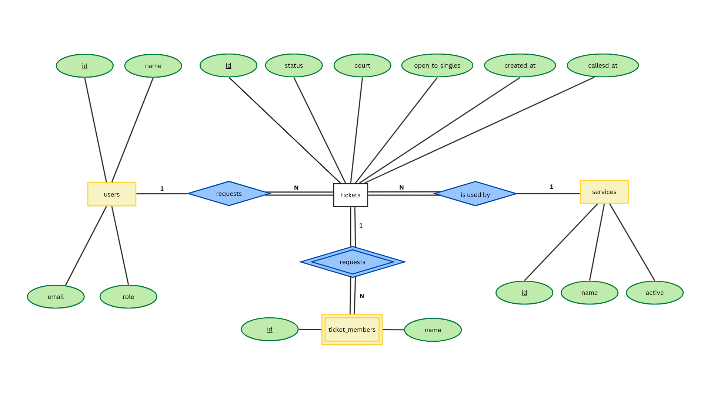

# ShuttleStack schema

## 2a. Nouns in the requirements

| Req ID | Requirement | Nouns | Table or column? |
| --- | --- | --- | --- |
| FR-01 | A **player** can join the **queue** as a **pair**, a **group of four**, or alone and get a **ticket**. | player, queue, ticket, pair, group of four | users, *(not a table)*, tickets, services (the three entry types), tickets.players |
| FR-02 | A player can see their **ticket number**, **status** and how many teams are **ahead**. | ticket number, status, ahead | tickets.id, tickets.status, *(computed)* |
| FR-03 | The **caretaker** can view the **waiting list** in order and **call**, **serve** or mark **no-show**. | caretaker, waiting list, call, serve, no-show | users (role staff), *(not a table: query of tickets with status waiting, ordered by created_at)*, tickets.status values called, served, no-show |
| FR-04 | A player can **leave** the queue. | leave | tickets.status value left *(soft delete, no new table)* |
| FR-05 | The caretaker sees which **courts** are in use and which **ticket** is on each. | court, ticket | tickets.court (integer 1 to 3, empty when not on a court); *not a table, because a court has no data of its own* |
| FR-06 | The caretaker can see how many **games** each waiting **team** has **played** and how long they have **waited**. | games played, team, wait time | *(computed)*: count of the person's tickets with status served, and now() minus tickets.created_at; nothing stored |
| FR-07 | The caretaker can call the next **game**: the system picks waiting tickets in join order that add up to exactly 4 **players**, never splitting a team, and assigns them to a free court. | game, players, join order, free court | tickets.players (integer 1, 2 or 4), tickets.created_at, tickets.court; *a game is not a table, it is the set of called tickets sharing one court* |
| FR-09 | The caretaker can add, rename and switch off a **service**, and cannot delete a service that has tickets. | service, name, active | services, services.name, services.active |
| FR-10 | The caretaker can delete a **ticket** that was created by **mistake**. | ticket, mistake | *(hard delete of a tickets row, no new column)* |
| FR-11 | A player who joins can mark that they are **open to a singles game**, and the caretaker can choose to start a singles game (2 players) on a free court when few players are at the venue. | open to singles, singles game | tickets.open_to_singles (boolean, default false) |

**Two rules applied:**

- **The queue is not a table.** It is all tickets with status `waiting`, ordered by `created_at`.
- **Store facts, not results.** Position in line, games played and wait time are computed when needed, never stored.

**Open question for 2b:** `partner` currently holds names such as "Eli, Fe, Gio" in one cell. That is a list in one cell, which the 1NF check in 2e will flag. We'll decide there whether to keep it as text or split it out.

## 2b. Tables and columns

| Table | Columns | What it stores |
| --- | --- | --- |
| users | id, name, email, role | A person. The same email on a return visit reuses the same row. Role is `visitor` or `staff`. |
| services | id, name, active | The three entry types. `active` lets the caretaker switch one off (FR-09). |
| tickets | id, user_id, service_id, status, court, open_to_singles, created_at, called_at | One visit to the queue. |
| ticket_members | id, ticket_id, name | The other players who came with the ticket owner, one name per row. |

**Where each Week 3 field went:**

| Week 3 field | Now | Why |
| --- | --- | --- |
| `name`, `email` | `users` | Facts about the person |
| `service_id` | `tickets.service_id` | Which entry type this visit used |
| `status`, `court` | `tickets` | Change every visit |
| `partner` ("Eli, Fe, Gio") | `ticket_members`, one row per name | A list in one cell breaks 1NF |
| `players` (1, 2 or 4) | *(computed)* 1 + count of members | A stored copy could drift out of sync |
| *(new)* `open_to_singles` | `tickets` | FR-11, a choice made per visit |

**Not stored on purpose:** position in line, games played, wait time and the number of players in a game. All of them can be computed.

## 2c. Types and constraints

| Table | Column | PostgreSQL type | Constraint | Why |
| --- | --- | --- | --- | --- |
| users | id | integer, generated | PRIMARY KEY | Generated by the database, never reused |
| users | name | varchar(80) | NOT NULL | A ticket needs a name the caretaker can call |
| users | email | varchar(120) | NOT NULL UNIQUE | One person per email, so a return visit reuses the row |
| users | role | varchar(20) | NOT NULL DEFAULT 'visitor', CHECK (role IN ('visitor', 'staff')) | Only two roles exist |
| services | id | integer, generated | PRIMARY KEY | Generated by the database |
| services | name | varchar(60) | NOT NULL UNIQUE | No two entry types with the same name (FR-09) |
| services | active | boolean | NOT NULL DEFAULT true | Lets the caretaker switch a service off (FR-09) |
| tickets | id | integer, generated | PRIMARY KEY | The ticket number, unique and never reused (NFR-02) |
| tickets | user_id | integer | NOT NULL REFERENCES users(id) ON DELETE RESTRICT | No ticket without a person |
| tickets | service_id | integer | NOT NULL REFERENCES services(id) ON DELETE RESTRICT | No ticket for a missing service |
| tickets | status | varchar(20) | NOT NULL DEFAULT 'waiting', CHECK (status IN ('waiting', 'called', 'served', 'no-show', 'left')) | Only these five statuses exist |
| tickets | court | integer | CHECK (court IS NULL OR court BETWEEN 1 AND 3) | Empty when not on a court; the venue has 3 courts (FR-05) |
| tickets | open_to_singles | boolean | NOT NULL DEFAULT false | The player's opt-in (FR-11) |
| tickets | created_at | timestamptz | NOT NULL DEFAULT now() | Join order and wait time, set by the database |
| tickets | called_at | timestamptz | *(nullable)* | Empty until the ticket is called |
| ticket_members | id | integer, generated | PRIMARY KEY | Generated by the database |
| ticket_members | ticket_id | integer | NOT NULL REFERENCES tickets(id) ON DELETE CASCADE | Members mean nothing without their ticket |
| ticket_members | name | varchar(80) | NOT NULL | One name per row (1NF) |

## 2d. ERD

**Foreign keys (shown as notes, not ovals, because Chen notation shows links through relationships):**

| Foreign key | Points to | Relationship in the ERD | Kind | On delete |
| --- | --- | --- | --- | --- |
| tickets.user_id | users.id | requests | 1 : N | RESTRICT |
| tickets.service_id | services.id | is used by | 1 : N | RESTRICT |
| ticket_members.ticket_id | tickets.id | includes | 1 : N | CASCADE |

The foreign key always sits on the "many" side.

**Relationships, read aloud:**

- One user requests many tickets over time. Each ticket belongs to exactly one user.
- One service is used by many tickets. Each ticket belongs to exactly one service.
- One ticket includes many ticket members. Each member belongs to exactly one ticket.

**What happens when a parent row is deleted:**

| Foreign key | Rule | Reason |
| --- | --- | --- |
| tickets.user_id | RESTRICT | A person with tickets cannot be deleted, because past tickets are history the caretaker needs for reports such as games played (FR-06). |
| tickets.service_id | RESTRICT | A service with tickets cannot be deleted, so old tickets never lose their entry type. This matches FR-09. Switch it off instead. |
| ticket_members.ticket_id | CASCADE | Members mean nothing without their ticket, so a mistaken ticket deleted under FR-10 takes its member names with it. |

**Notes on the diagram:**

- Primary keys are underlined. `ticket_members` is a weak entity (double rectangle) because it cannot exist without its ticket.
- Position in line, games played, wait time and number of players are computed, not stored.
- "A player has only one active ticket at a time" is a business rule, not a cardinality, so the user-to-ticket relationship stays 1 : N.

## 2e. Normalization check

**1. One value per cell (1NF): does any column hold a list?**
No. In Week 3, `partner` held "Eli, Fe, Gio" in one cell. I moved it to `ticket_members`, with one name per row, so no column holds a list. `players` is no longer stored either, because it is computed as 1 plus the number of members.

**2. Depends on the whole key (2NF): in each join table, does every extra column depend on both keys?**
There is no many-to-many relationship in ShuttleStack, so there is no join table. `ticket_members` is not a join table: it has its own single-column primary key (`id`), and its `name` depends on that row only. Every other table also has a single-column primary key, so no column can depend on only part of a key.

**3. No hidden copies (3NF): would I ever update the same fact in more than one row?**
No. A person's name and email are stored once in `users`, and tickets point to them with `user_id`. A service's name is stored once in `services`, and tickets point to it with `service_id`. Position in line, games played, wait time and number of players are computed when needed, so nothing can drift out of sync.

**One thing I checked and kept:** `ticket_members.name` is free text, not a link to `users`, because the people listed as partners may never use the app. If one of them also joins as a user, their name exists in two places, but these are two different facts (a name typed by a friend, and an account's own name), so I did not merge them.